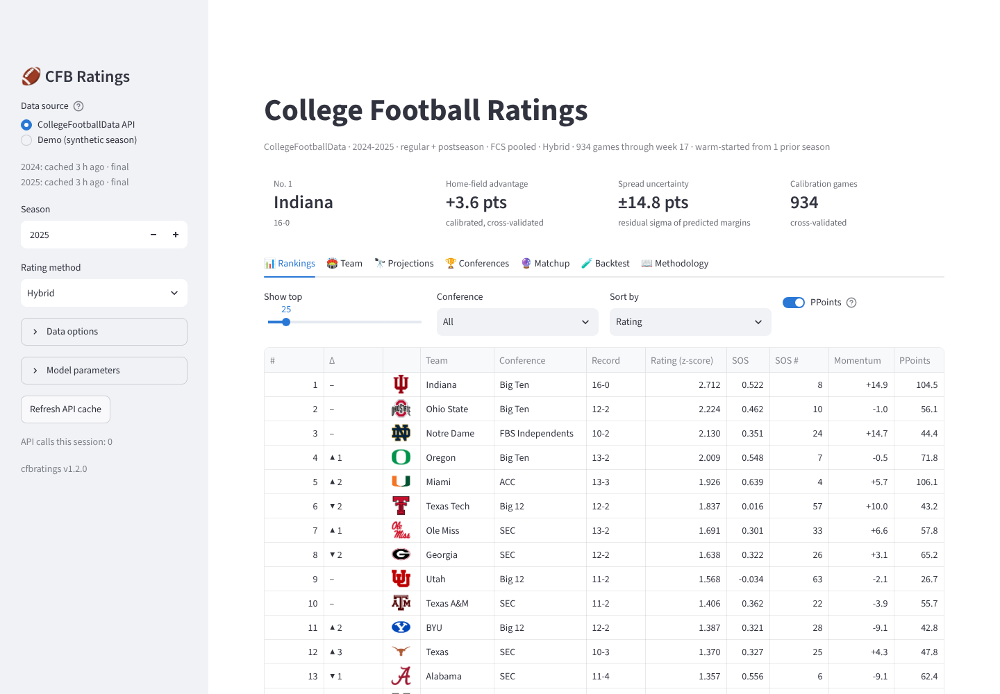

# BrandonCFBRatings 🏈

[](https://github.com/bpaikoff/BrandonCFBRatings/actions/workflows/ci.yml)

[](https://github.com/astral-sh/ruff)
[](LICENSE)

A college football ratings engine with five rating systems, résumé analytics, a walk-forward
backtesting harness and an interactive dashboard. Every model is calibrated to point spreads and
win probabilities on the same scale, so you can ask the only question that matters: **which
system actually predicts games?**

**Live at [cfb.tzadek.ai](https://cfb.tzadek.ai)**

| | |
|---|---|
| **Models** | Colley, Massey (ridge, recency-weighted), Elo (margin-of-victory), Bradley-Terry, Hybrid blend — all warm-startable from the previous season |
| **Analytics** | strength of schedule, momentum in points, conference strength index, PPoints résumé score, weekly rank trajectories, exact rest-of-season record projections |
| **Backtesting** | out-of-sample walk-forward evaluation across one or many seasons: accuracy, Brier, log loss, MAE/RMSE, calibration, home-team baseline, Vegas closing-line comparison, grid-search tuning |
| **Interfaces** | `cfbratings` CLI with CSV/JSON export · Streamlit dashboard ([cfb.tzadek.ai](https://cfb.tzadek.ai)) · importable Python package |
| **Data** | [CollegeFootballData.com](https://collegefootballdata.com) API behind a two-tier cache (working cache plus a committed archive of finished seasons, so a season costs two or three API calls ever; the 2021–2025 seasons ship in the archive), FCS opponents pooled rather than dropped, or a synthetic multi-season generator for offline use |

## Quickstart

```bash
git clone https://github.com/bpaikoff/BrandonCFBRatings.git
cd BrandonCFBRatings
pip install -e ".[app]"          # add ,dev for tests + lint

# No API key? Everything runs on a synthetic season with known ground truth.
cfbratings --demo rank
cfbratings --demo backtest

# Real data: get a free key at https://collegefootballdata.com/key
cp .env.example .env             # then set CFBD_API_KEY=...
cfbratings rank --year 2025 --warmup-years 1 --method hybrid --top 25   # seeded from 2024
cfbratings backtest --years 2022-2025 --start-week 1                    # multi-season evaluation
streamlit run apps/streamlit_app.py
```

## Command line

| Command | What it does |
|---|---|
| `cfbratings rank` | ratings table with record, SOS, momentum and PPoints (`--method`, `--top`, `--sort-by`, `--conference`, `--csv/--json`) |
| `cfbratings team "Ohio State"` | one team's schedule with expected vs. actual margins and its week-by-week rank |
| `cfbratings conferences` | conference strength index |
| `cfbratings predict "Ohio State" "Michigan" [--neutral]` | spread and win probability from every model |
| `cfbratings project` | rest-of-season projections: projected record, P(6+/10+ wins), P(win out), next opponent |
| `cfbratings backtest` | walk-forward comparison of all methods (`--methods`, `--start-week`, `--by-week`, `--calibration`, `--lines` for a Vegas comparison, `--predictions-csv`) |
| `cfbratings tune --method elo --grid "k=15,25,40;hfa=2,2.5,3"` | grid search hyper-parameters against any backtest metric |
| `cfbratings snapshot` | compute and cache weekly rating snapshots |
| `cfbratings cache list\|clear` | inspect the JSON cache |

Global flags: `--year`, `--years 2022-2024`, `--warmup-years N` (load N earlier seasons and seed the ratings from them), `--fcs {pool,drop}`, `--season-type {regular,postseason,both}`, `--demo`, `--demo-weeks N` (mid-season demo), `--refresh`, `--cache-dir`, `--param KEY=VALUE` (per-model overrides such as `--param k=30`).

Example (real data: the 2025 season warm-started from 2024, and the five-season walk-forward):

```
$ cfbratings --year 2025 --warmup-years 1 rank --top 5
Hybrid ratings — 2025 — CFBD 2024-2025 (both, FCS pooled) — warm-started from 1 prior season
calibration: HFA +3.59 pts, slope 10.627, sigma 14.8 pts (cross_val, n=934)

 rank       team       conference record  rating    sos  sos_rank  momentum  ppoints
    1    Indiana          Big Ten   16-0   2.712  0.522         8    14.923  104.525
    2 Ohio State          Big Ten   12-2   2.224  0.462        10    -0.967   56.148
    3 Notre Dame FBS Independents   10-2   2.130  0.351        24    14.730   44.419
    4     Oregon          Big Ten   13-2   2.009  0.548         7    -0.474   71.847
    5      Miami              ACC   13-3   1.926  0.639         4     5.676  106.069

$ cfbratings --years 2021-2025 backtest --start-week 1 --lines
               method    n  accuracy  brier  log_loss     mae    rmse   seasons weeks  ats_accuracy  vegas_mae
               colley 4457    0.7168 0.1840    0.5431 14.1497 17.9010 2021-2025  1-17        0.5002    12.1126
               massey 4457    0.7361 0.1718    0.5113 13.2929 16.8195 2021-2025  1-17        0.4970    12.1126
                  elo 4457    0.7195 0.1794    0.5323 13.9076 17.6065 2021-2025  1-17        0.4909    12.1126
        bradley_terry 4457    0.7148 0.1820    0.5377 14.0671 17.7728 2021-2025  1-17        0.4868    12.1126
               hybrid 4457    0.7303 0.1722    0.5119 13.2145 16.7118 2021-2025  1-17        0.4939    12.1126
home_prior (baseline) 4457    0.6280 0.2415    0.6790 18.2180 22.7548 2021-2025  1-17           NaN        NaN
 vegas (closing line) 4435    0.7547 0.1617    0.4826 12.1126 15.2734       NaN   NaN           NaN        NaN
```

Both commands run with **zero** API calls on a fresh clone: the 2021–2025 seasons ship in
`data/archive/`. With `--demo` the same commands run on a synthetic season whose numbers are
illustrative only.

## Dashboard

The dashboard is live at **[cfb.tzadek.ai](https://cfb.tzadek.ai)** (see [Deployment](#deployment)).
Locally, `streamlit run apps/streamlit_app.py` opens the same seven-tab app, which works in demo mode
without a key (`make app` pins BLAS to one thread, see below):



* **Rankings** – logos, rank change since the previous week (▲ 3, ▼ 2, new), sortable table with a conference filter, ranked bar chart coloured by team or by conference, rating-vs-SOS scatter, CSV download
* **Team** – header strip in the team's colours, schedule with expected margin and win probability per game, opponent logos, the next game with its kickoff day and win probability, week-by-week rank trajectory (compare up to eight teams; look-alike colours get dashed lines), projected record and win-total distribution
* **Projections** – every team's remaining schedule turned into exact win-total odds (bowl eligibility, 10+ wins, win out) with the next opponent
* **Conferences** – robust strength index with aggregate records
* **Matchup** – pick any two teams for every model's spread and win probability plus a consensus line
* **Backtest** – run the walk-forward evaluation live: metrics table, per-week accuracy (weeks with fewer than five games hidden), reliability diagram, by-season tables, downloadable predictions
* **Methodology** – the formulas, rendered from `docs/METHODOLOGY.md`

Every model hyper-parameter (home-field advantage, Elo K, Massey ridge and recency half-life, hybrid weights, …) is a sidebar slider; results are cached so interaction is instant. The sidebar also says where each loaded season comes from (archived, cached N hours ago, or not cached and about to call the API) and how many API calls the session has made, so the free tier's budget is always visible.

The page is pinned to the light theme (`.streamlit/config.toml`) so charts and page always agree; for dark mode launch with `STREAMLIT_THEME_BASE=dark streamlit run apps/streamlit_app.py` and the logos, charts and colours switch with it.

## How it works

Full derivations live in [`docs/METHODOLOGY.md`](docs/METHODOLOGY.md). In brief:

| Model | Uses | Core idea |
|---|---|---|
| **Colley** | W/L | Laplace-prior linear system `(2+nᵢ)rᵢ − Σ r_opp = 1 + (wᵢ−lᵢ)/2`; immune to margin, blind to it too |
| **Massey** | margins | ridge least squares on `r_home − r_away = margin − HFA`; margins capped, optional recency weighting, automatically centred |
| **Elo** | sequence + margins | FiveThirtyEight-style update with `ln(margin+1)` multiplier damped by the winner's edge; HFA converted to Elo (25/pt); regression between seasons only |
| **Bradley-Terry** | W/L | penalised logistic MLE `P(home) = σ(r_h − r_a + η)` fitted by Newton's method |
| **Hybrid** | all | weighted blend of z-scored component ratings |

**Calibration.** Ratings are turned into spreads and probabilities with `margin = HFA + slope × (r_h − r_a)` and `P = Φ(margin/σ)`. The calibrator is fitted by *k-fold cross-validation* (each game predicted by a model that never saw it) with a degrees-of-freedom-corrected σ, which stops a one-parameter-per-team model from looking overconfident in September.

**Warm starts.** Every model accepts a prior: last season's final ratings regressed a third of the way to the mean (`CFB_SEASON_REGRESS`). Colley plays its pseudo-games at the prior, Massey shrinks toward it, Elo starts from it, Bradley-Terry penalises distance from it. Load earlier seasons with `--warmup-years` (CLI) or the sidebar control (dashboard) and September ratings stop being coin flips.

**FCS games.** Opponents outside FBS are pooled into one pseudo-team that is rated but never ranked, so a loss to an FCS program costs what it should instead of vanishing from the data (`--fcs drop` restores the old behaviour).

**Projections.** Each unplayed game gets a calibrated win probability; the remaining-wins distribution is the exact Poisson-binomial sum, so "P(10+ wins)" is computed, not simulated.

**PPoints** is a committee-style résumé score: wins earn tier points by the opponent's rank (blended between its rank *entering that week* and its rank *now*), multiplied by a road/neutral bonus and the opponent's conference strength; losses cost `4 ÷ tier`, so losing to #3 barely stings while losing to #90 costs four points. Non-conference games earn a bonus and a softer loss penalty.

## Backtesting

The engine refits the model each week on every earlier game, calibrates on cross-validated and previously held-out predictions, and scores that week's games out-of-sample. Given several seasons it walks them in order and warm-starts each one from the regressed ratings of the season before, so evaluation can begin in week 1. Two reference rows accompany every run: **home_prior** (always pick the home team) and, with `--lines`, the **Vegas closing spread**. A system that cannot beat the home-team baseline is noise; one that approaches the market is excellent.

```bash
cfbratings backtest --years 2022-2024 --methods massey,elo,hybrid --start-week 1 --lines --by-week
cfbratings tune --years 2023-2024 --method massey --grid "prior_lambda=1,3,5;ridge_lambda=0.5,1,2" --metric brier
```

On real seasons the warm start improves every model on identical weeks: grading 2025 from week 4, Massey's log loss falls 0.536 → 0.521 and its MAE 12.4 → 12.1 points when the ratings are seeded from 2024, and weeks 1–3 become gradable at all. Over 2021–2025 (4 457 games from week 1) warm-started Massey posts 0.511 log loss and 13.3 points of MAE against 0.679 / 18.2 for the home-team baseline and 0.483 / 12.1 for the closing line. The full real-data results, including the tuning grids and their 2025 hold-out, are in [`docs/BACKTEST_RESULTS.md`](docs/BACKTEST_RESULTS.md).

From Python:

```python
from cfbratings import fit_ratings, MarginCalibrator
from cfbratings.data import load_season
from cfbratings.backtest import compare_methods

teams, games = load_season(2024)
names = [t.school for t in teams]
table, results = compare_methods(names, games, ["massey", "elo", "hybrid"], start_week=4)
print(table)
```

## Configuration

Settings come from environment variables or a `.env` file (see [`.env.example`](.env.example)):

| Variable | Default | Meaning |
|---|---|---|
| `CFBD_API_KEY` | – | CollegeFootballData API key |
| `CFB_YEAR` / `CFB_SEASON_TYPE` | current season / `both` | default season |
| `CFB_CACHE_DIR` / `CFB_CACHE_TTL_HOURS` | `data/cache` / `6` | working JSON cache (finished seasons never expire) |
| `CFB_ARCHIVE_DIR` | `data/archive` | gzipped payloads of finished seasons, committed to the repo so a fresh clone never re-downloads them |
| `STREAMLIT_THEME_BASE` | `light` (from `.streamlit/config.toml`) | `dark` switches the dashboard, its logos and charts to the dark theme |
| `CFB_HFA` | `2.5` | home-field advantage in points (never applied on neutral sites) |
| `CFB_COLLEY_PRIOR` | `2.0` | Colley pseudo-games |
| `CFB_MASSEY_LAMBDA` / `CFB_MASSEY_MAX_MARGIN` / `CFB_MASSEY_HALF_LIFE` / `CFB_MASSEY_PRIOR_LAMBDA` | `1.0` / `50` / `0` / `3.0` | Massey ridge, margin cap, recency half-life (weeks), ridge toward a preseason prior |
| `CFB_ELO_K` / `CFB_ELO_INIT` / `CFB_ELO_PER_POINT` / `CFB_ELO_MOV` | `25` / `1500` / `25` / `1` | Elo parameters |
| `CFB_SEASON_REGRESS` | `0.33` | fraction of last season's rating regressed to the mean when warm-starting (all models) |
| `CFB_FCS` | `pool` | `pool` FCS opponents into one pseudo-team or `drop` those games |
| `CFB_BT_RIDGE` | `1.0` | Bradley-Terry L2 penalty |
| `CFB_HYBRID_WEIGHTS` | `colley=0.2,massey=0.6,elo=0.2` | hybrid blend (tuned on real seasons, see [`docs/BACKTEST_RESULTS.md`](docs/BACKTEST_RESULTS.md)) |

## Project layout

```
cfbratings/
  config.py          settings from env / .env
  data/              Game & Team schema, JSON cache, CFBD client, synthetic seasons
  models/            colley, massey, elo, bradley_terry, hybrid + registry
  predict.py         MarginCalibrator: ratings → spreads & win probabilities
  priors.py          preseason priors / warm starts chained across seasons
  projections.py     exact rest-of-season win-total distributions
  analytics.py       records, SOS, momentum, conference strength, team/schedule tables
  ppoints.py         PPoints résumé metric
  snapshots.py       weekly rating snapshots (cached)
  backtest/          walk-forward engine, metrics, grid search
  viz/               Plotly charts (colour-blind-safe palette)
  cli.py             `cfbratings` command
apps/streamlit_app.py  dashboard
docs/METHODOLOGY.md    formulas
tests/                 pytest suite (models, calibration, analytics, backtest, CLI, dashboard)
```

## Deployment

[cfb.tzadek.ai](https://cfb.tzadek.ai) is a [Railway](https://railway.app) service built from the
[`Dockerfile`](Dockerfile) in this repo, behind Cloudflare, the same arrangement as
[tzadek.ai](https://tzadek.ai). Railway detects the Dockerfile on its own; the container binds the
`$PORT` Railway injects. [`.railway/railway.ts`](.railway/railway.ts) declares the rest (GitHub
source, Streamlit's `/_stcore/health` health check, the custom domain) for Railway's
Infrastructure as Code CLI; its predecessor `railway.json` is deprecated and ignored for new
services.

```bash
docker build -t cfbratings .                                    # the image Railway builds
docker run --rm -p 8501:8501 -e CFBD_API_KEY=... cfbratings     # http://localhost:8501
```

The image carries the committed `data/archive/` (2021–2025), so the only API calls a fresh
container makes are the two or three for the season in progress, refreshed every
`CFB_CACHE_TTL_HOURS`. The working cache under `data/cache/` is ephemeral unless a Railway volume
is mounted at `/app/data/cache`.

Setting it up (one-time, in the Railway and Cloudflare dashboards):

1. Railway → **New Project → Deploy from GitHub repo** → `bpaikoff/BrandonCFBRatings`, branch
   `master`. Railway finds the Dockerfile and builds it; every push to `master` redeploys. Set
   **Settings → Deploy → Healthcheck Path** to `/_stcore/health`. (Equivalent from the CLI:
   `railway link`, `railway config plan`, `railway config apply`, which reads `.railway/railway.ts`
   and also attaches the domain from step 3.)
2. Service → **Variables**: `CFBD_API_KEY` (the free key from
   [collegefootballdata.com/key](https://collegefootballdata.com/key)). Without it the site starts
   in demo mode. Optional: `STREAMLIT_THEME_BASE=dark`, any `CFB_*` override from the table above.
3. Service → **Settings → Networking → Custom Domain** → `cfb.tzadek.ai`. Railway shows two DNS
   records to create, a `CNAME` and a `TXT` verification record; both are required (with only the
   CNAME the domain never verifies and serves a 404).
4. Cloudflare → `tzadek.ai` zone → **DNS** → add both records exactly as shown: the `CNAME` with
   name `cfb` and the Railway target, proxy status **Proxied**, and the `TXT` record. The zone's
   SSL/TLS mode must be **Full** (Railway terminates TLS itself; **Flexible** would loop and
   Railway advises against **Full (strict)**). Railway issues the certificate once the records resolve,
   usually within a few minutes; if it stays on "Waiting for DNS update", switch the CNAME to
   **DNS only** until the certificate is issued, then re-enable the proxy.

Streamlit talks to the browser over a WebSocket, which Cloudflare proxies by default; no
page rules are needed. `tzadek.ai` sends `Strict-Transport-Security` with `includeSubDomains`, so
`cfb.tzadek.ai` is HTTPS-only from the first visit, which is what Railway serves.

## Development

```bash
make install     # pip install -e ".[dev]"
make lint        # ruff check + format check
make test        # pytest (~75 tests, ~1 min incl. dashboard smoke test)
make test-fast   # skip the dashboard smoke test
make app         # streamlit run apps/streamlit_app.py
make docker      # build the deployment image and run it on http://localhost:8501
```

CI runs lint and the test-suite on Python 3.11–3.13 for every push and pull request. Models and the backtest engine are validated against synthetic seasons with known team strengths, so the tests assert that each system recovers the true ordering and beats the home-team baseline out of sample; the parsers are also checked against a real trimmed 2024 payload. The suite never touches the network, even with a real `CFBD_API_KEY` in the environment.

## Roadmap

* Preseason priors that also use returning production / recruiting, not just last season
* Conference-title and playoff odds on top of the projections (needs tiebreak and selection rules)
* Offense / defense split ratings (Massey decomposition)

## Acknowledgements

Game data from [CollegeFootballData.com](https://collegefootballdata.com). Rating methods follow Colley (2002), Massey (1997), the FiveThirtyEight Elo formulation, and Bradley & Terry (1952).
